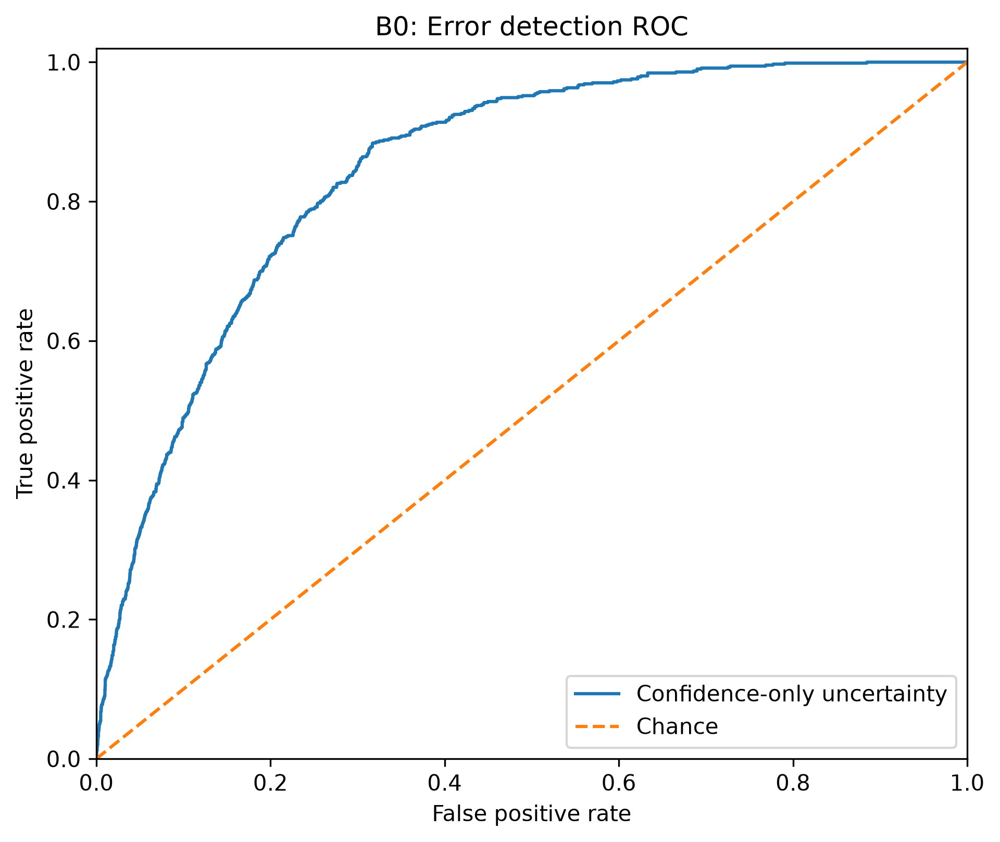
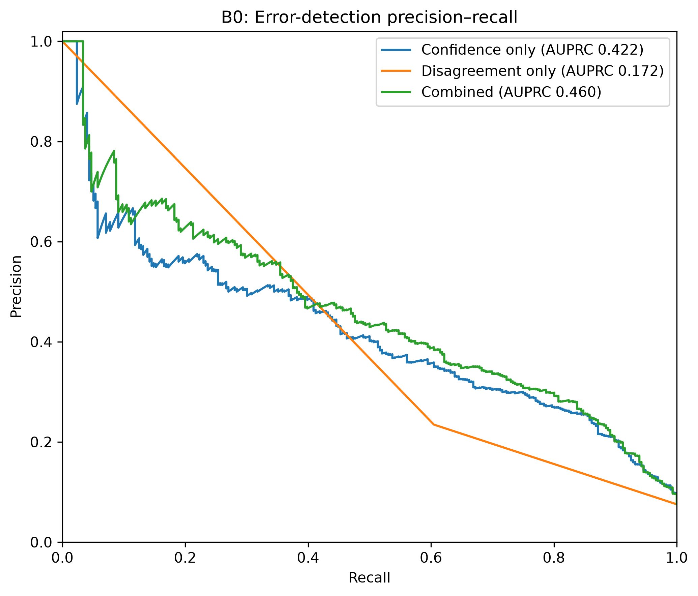
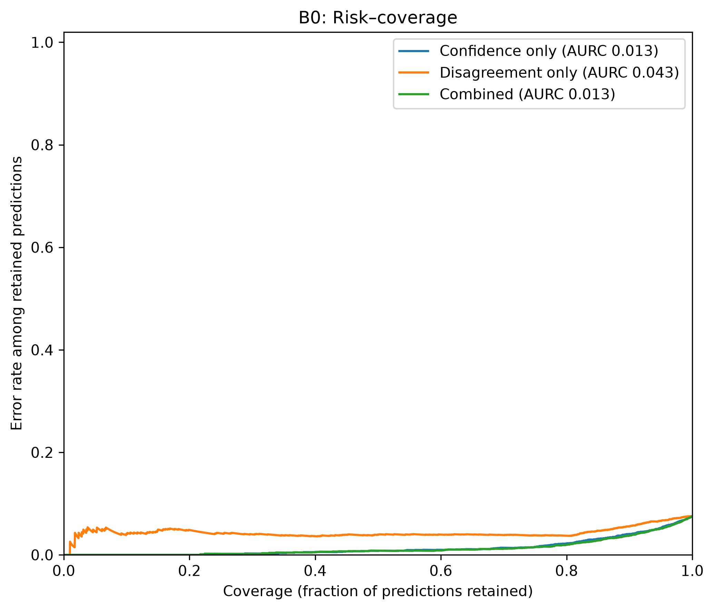
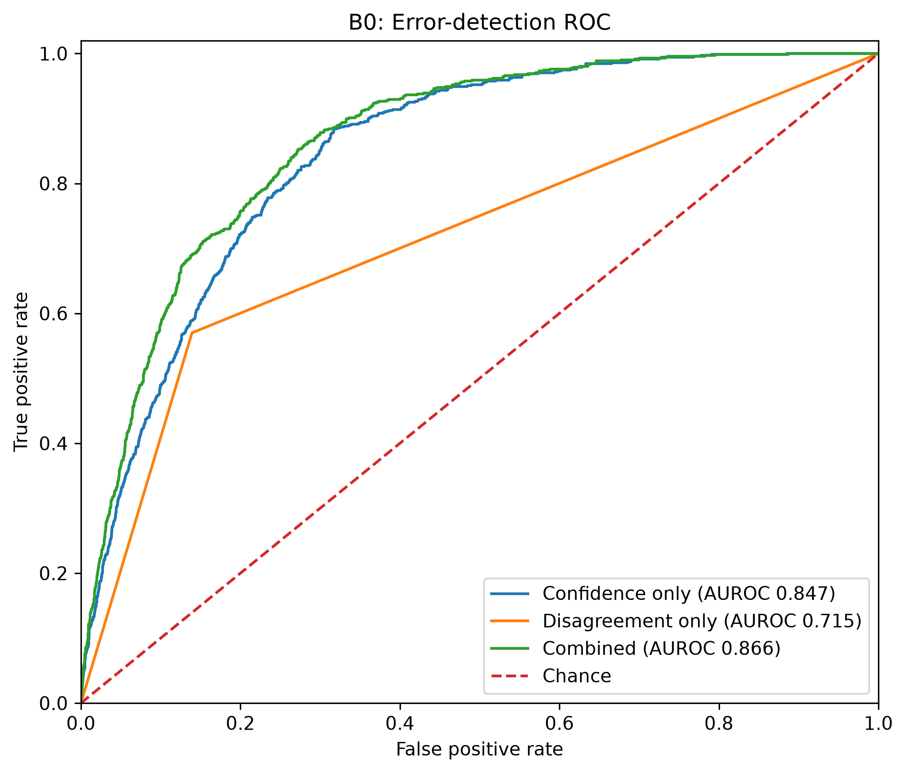
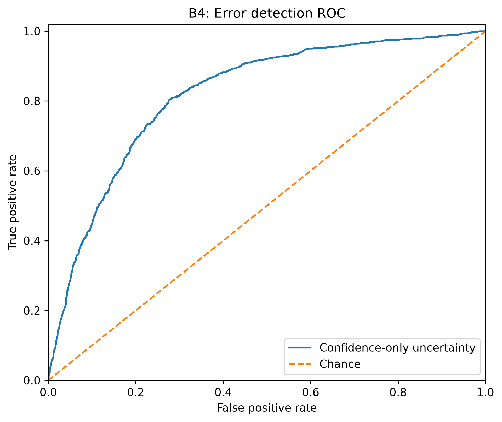
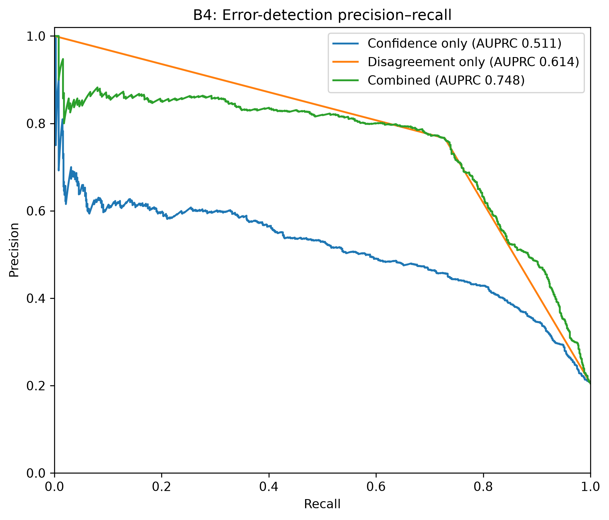
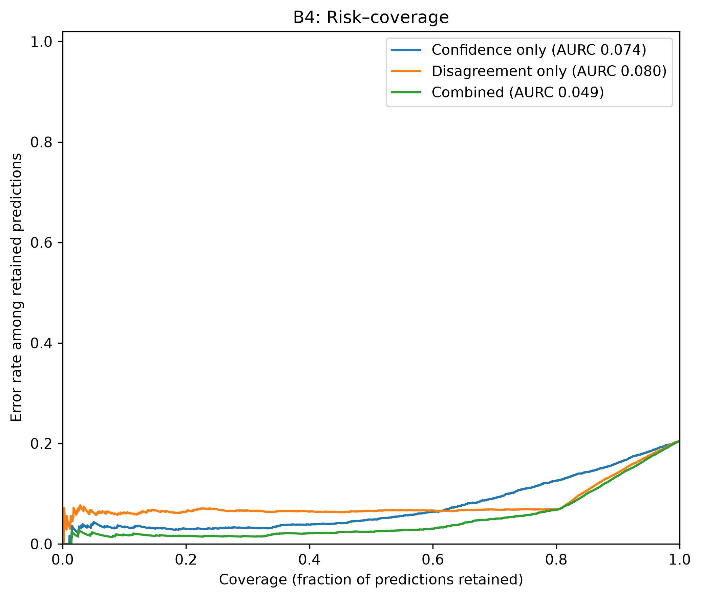
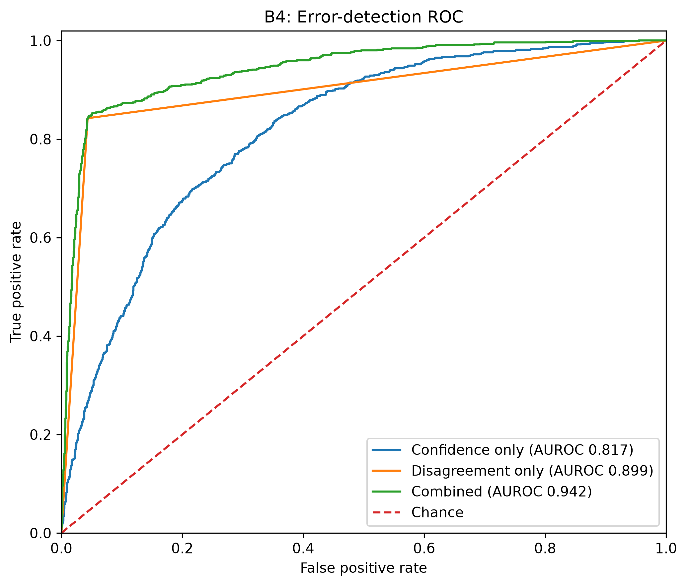
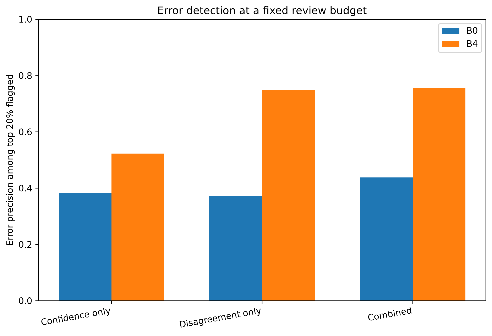

# Beyond Confidence Scores: Disagreement-Aware Error Detection in Skin Lesion Classification Using EfficientNet-B0 and EfficientNet-B4

# Abstract

**Background:** A classifier's confidence does not always reflect whether its prediction is correct. When two models predict different classes for the same skin-lesion image, that disagreement may offer another clue about the reliability of their predictions.

**Objective:** This study examines whether disagreement between EfficientNet-B0 and EfficientNet-B4 helps identify incorrect predictions beyond confidence-based uncertainty, and whether its usefulness differs between the two models.

**Methods:** We evaluated three error-detection scores: confidence-based uncertainty, binary disagreement between the models, and a weighted combination of both. The evaluation used a filename-deduplicated test set of 3,921 images. Combination weights were selected on the validation set. We measured AUROC, AUPRC, and precision, recall, and F1 when flagging the highest-risk 20% of predictions. Paired bootstrap resampling was used to estimate uncertainty in differences between methods.

**Results:** For EfficientNet-B0, the combined score achieved an AUROC of 0.893 and an AUPRC of 0.460, compared with 0.886 and 0.422 for confidence alone. The paired 95% bootstrap confidence intervals for the differences excluded zero for AUROC and AUPRC, but not for precision, recall, or F1 at the 20% flagging threshold. For EfficientNet-B4, the combined score achieved an AUROC of 0.942 and an AUPRC of 0.812, compared with 0.817 and 0.496 for confidence alone. The paired confidence intervals excluded zero for all five metrics.

**Conclusion:** Disagreement contributed differently to error detection for the two models. Combining disagreement with confidence improved ranking performance for both, but clear evidence of improvement in fixed-budget detection was found only for EfficientNet-B4. These findings apply to the evaluated dataset and image-level split. Filename deduplication does not establish patient- or lesion-level independence, and external validity and clinical utility remain untested.

**Keywords:** skin-lesion classification; predictive uncertainty; model disagreement; error detection; EfficientNet; selective prediction

# 1. Introduction

Deep learning is widely studied for automated skin-lesion classification, but a predicted class alone does not tell us how reliable that prediction is. A model can assign high confidence to an incorrect class, just as it can make a correct prediction with relatively low confidence. This creates a practical problem: beyond measuring how often a model is wrong, can we identify which predictions are more likely to be wrong?

One common approach is to use the model's confidence as a measure of prediction uncertainty. Under this approach, predictions with lower maximum class probabilities are assigned higher error risk. However, confidence is not the same as correctness. Guo et al. (2017) showed that modern neural networks can be poorly calibrated, highlighting the need to examine their probability estimates rather than assume that confidence reliably reflects predictive reliability. Calibration and error detection are related, but they address different questions. This study focuses on whether a score can rank incorrect predictions ahead of correct ones, rather than whether predicted probabilities match observed frequencies.

Disagreement between models offers another possible signal. Two models may assign different classes to the same image because they have learned different representations or respond differently to features in the image. Such disagreement does not guarantee that a prediction is wrong, but it may help identify cases that deserve closer examination. Deep ensembles have been studied as a way to estimate predictive uncertainty (Lakshminarayanan et al., 2017), while Dakhli and Barhoumi (2024) investigated model complementarity and Dempster–Shafer evidence fusion for skin-lesion classification. These studies provide relevant context, although using disagreement to improve a final classification and using it to rank a model's likely errors are distinct objectives.

The distinction matters when the goal is to prioritize predictions for review. A method that improves the final classification may not necessarily be the best method for identifying errors made by an individual model. Conversely, an error-detection score can be useful for ranking predictions by risk without changing their predicted classes. Selective classification addresses a related problem by examining how prediction coverage and error risk change when a system abstains on selected cases (Geifman and El-Yaniv, 2017).

This study examines whether disagreement between EfficientNet-B0 and EfficientNet-B4 helps identify incorrect predictions beyond confidence-based uncertainty. For each target model, we compare three scores: confidence-derived uncertainty, a binary indicator of disagreement between the models, and a weighted combination of the two. The combination weight is selected using validation data, and the resulting methods are evaluated on a held-out test split. Performance is measured using the area under the receiver operating characteristic curve (AUROC), the area under the precision–recall curve (AUPRC), and precision, recall, and F1 when flagging the highest-risk 20% of predictions. Paired bootstrap comparisons are used to estimate uncertainty in differences between methods.

The study makes three contributions. First, it provides a direct comparison of confidence-only, disagreement-only, and combined error-detection scores for EfficientNet-B0 and EfficientNet-B4 on a shared, filename-deduplicated test set. Second, it examines whether disagreement contributes similarly to error detection for both target models, rather than assuming that its value is uniform. Third, it evaluates ranking performance alongside fixed-budget detection metrics and paired bootstrap confidence intervals, allowing differences between methods to be assessed more carefully.

The findings should be interpreted within the limits of the available data. Removing repeated filenames reduces exact filename duplication across the evaluation splits, but it does not establish that images are independent at the patient or lesion level. The study also does not evaluate external datasets or clinical workflows. Its purpose is to compare error-detection signals under the specified experimental conditions, not to establish clinical effectiveness or generalization to independently collected patient populations.

# 2. Related Work

## 2.1 Confidence and predictive uncertainty

Maximum softmax probability is a widely used indicator of a neural network's confidence in its predicted class. For error detection, one minus this probability can be used as an uncertainty score, with larger values indicating lower confidence and therefore higher estimated error risk. This is a convenient baseline, but its usefulness depends on how well the score separates incorrect predictions from correct ones.

Guo et al. (2017) examined the calibration of modern neural networks and showed that high predictive confidence does not necessarily correspond to the same level of empirical accuracy. Calibration concerns the agreement between predicted probabilities and observed outcomes, whereas error detection concerns the ranking of predictions by their likelihood of being incorrect. The two are related, but neither should be treated as a direct substitute for the other. Accordingly, the present study evaluates confidence-derived uncertainty using error-detection metrics rather than treating confidence as a calibrated probability of error.

Lakshminarayanan et al. (2017) studied deep ensembles as a practical approach to predictive uncertainty estimation. Ensembles use information from multiple models, providing a broader view of predictive behavior than the output of a single model alone. The disagreement signal used here is simpler: it records whether EfficientNet-B0 and EfficientNet-B4 predict different classes for the same image. It is a binary indicator, not a full probabilistic estimate of uncertainty, and its value must be established empirically.

## 2.2 Uncertainty estimation in skin-lesion classification

Uncertainty estimation has been investigated directly in skin-lesion classification. Lee et al. (2021) proposed joint dermatological lesion classification and confidence modeling, exploring how confidence-related information can be learned alongside lesion predictions. Their approach differs from the present evaluation, which compares error-detection scores for two existing EfficientNet models rather than jointly training a confidence-estimation component.

Mazoure et al. (2022) introduced DUNEScan, a web-based tool for skin-cancer detection that reports uncertainty alongside model predictions. Their work demonstrates the relevance of communicating predictive uncertainty in a skin-lesion classification setting. However, uncertainty estimation and error ranking are not identical tasks: an uncertainty measure may describe aspects of a prediction's reliability without necessarily providing the best ranking of incorrect predictions under a particular evaluation metric.

Fayyad et al. (2024) evaluated conformal prediction, Monte Carlo dropout, and evidential deep learning for uncertainty quantification across medical-imaging datasets, including pigmented skin lesions. Their work broadens the range of uncertainty approaches considered in medical image analysis. These techniques differ in their assumptions and outputs, whereas the present study focuses on a direct comparison between confidence-derived uncertainty and a binary disagreement signal from two EfficientNet architectures.

## 2.3 Disagreement and ensemble methods in skin-lesion classification

Dakhli and Barhoumi (2024) examined model complementarity and disagreement in skin-lesion classification and proposed an ensemble method based on Dempster–Shafer evidence fusion. Their work is particularly relevant because it investigates how differences between models can contribute to an ensemble's classification behavior.

The objective here is different. Rather than using disagreement primarily to construct a fused classifier, this study treats disagreement as a score for ranking the errors of each target model. For an image on which the two models predict different classes, the disagreement score is one; otherwise, it is zero. The score is evaluated on its own and in combination with confidence-derived uncertainty for the target model. This allows the contribution of disagreement to be measured without assuming that disagreement always signals an incorrect prediction or that it improves both models equally.

## 2.4 Selective prediction and identification of difficult cases

Selective classification examines systems that can abstain from making predictions on selected examples, trading prediction coverage for reduced error risk. Geifman and El-Yaniv (2017) developed a selective-classification framework for deep neural networks in which risk is assessed as coverage changes. This provides a useful basis for evaluating error-detection scores: if high-risk predictions can be ranked effectively, a reviewer or downstream system can prioritize them while retaining the remaining predictions.

Koole et al. (2026) compared five uncertainty-quantification methods on a heterogeneous skin-lesion dataset: Monte Carlo dropout, DropConnect, Flipout, deep ensembles, and deep uncertainty quantification. Their evaluation considered classification performance, calibration, uncertainty decomposition, and risk-coverage behavior. They reported substantial agreement among the methods in their ranking of difficult samples. This finding is relevant because it shows that uncertainty-based identification of difficult cases has already received direct attention in skin-lesion research.

The present study addresses a more specific comparison. Instead of comparing several uncertainty-quantification methods, it evaluates binary disagreement between EfficientNet-B0 and EfficientNet-B4 against each target model's confidence-derived uncertainty. It also evaluates a validation-weighted combination of the two signals. The study therefore examines whether this simple disagreement indicator adds useful information for ranking model errors, and whether that contribution differs between the two target models.

## 2.5 Research gap and study positioning

Prior research has examined confidence calibration, predictive uncertainty, confidence-aware skin-lesion classification, ensemble disagreement, and selective prediction. Studies have also investigated uncertainty estimation and the identification of difficult samples in skin-lesion datasets. The present study does not claim that disagreement or uncertainty-based error detection is a new idea.

Instead, it investigates the empirical value of a specific signal and comparison: whether binary disagreement between EfficientNet-B0 and EfficientNet-B4 improves the ranking of each target model's incorrect predictions beyond confidence-derived uncertainty, and whether a weighted combination performs better than either signal alone. Confidence-only, disagreement-only, and combined scores are compared using validation-selected weights, a held-out test set, AUROC, AUPRC, fixed-budget precision, recall and F1, and paired bootstrap confidence intervals.

The conclusions are limited to the evaluated models, dataset, and split. Filename-level deduplication removes repeated filenames across the evaluation partitions, but it does not establish patient- or lesion-level independence. The study also does not provide external validation or demonstrate clinical utility. Its contribution is an empirical comparison of error-detection signals under these constraints, not evidence that the method is ready for clinical use.

# 3. Methods

## 3.1 Study objective

This study evaluated whether disagreement between EfficientNet-B0 and EfficientNet-B4 improves the detection of incorrect skin-lesion classification predictions beyond confidence-based error detection.

## 3.2 Dataset and preprocessing

The original combined dataset contained 36,346 rows. Duplicate image filenames occurred across data sources. A total of 197 filenames had conflicting diagnosis labels, recorded as `akiec` in HAM10000 and `scc` in ISIC2019. These filenames were excluded rather than assigning an arbitrary label.

The resulting evaluation manifest contained 26,134 unique image filenames across nine diagnostic classes. The manifest was used to construct the training, validation, and test splits.

Model-specific deterministic evaluation preprocessing was applied. EfficientNet-B0 used an input size of 224 × 224 pixels, while EfficientNet-B4 used 380 × 380 pixels. The evaluation transforms included normalization and tensor conversion. Both models were evaluated on the same split assignments, using their respective input sizes.

## 3.3 Data splitting

The deduplicated manifest was divided into training, validation, and test subsets using two-stage stratified splitting by diagnosis, with a fixed random seed of 42. The resulting split contained 18,293 training images, 3,920 validation images, and 3,921 test images.

Split assignments were saved in `split_manifest_deduplicated.csv`. Filename-level deduplication prevented identical filenames from appearing in multiple splits. However, patient-level and lesion-level independence were not established, and overlap among differently named images has not been ruled out.

## 3.4 Error-detection methods

An incorrect classification was defined as an error event. Three error-detection signals were compared for each target model:

1. **Confidence-only:** the model's classification uncertainty, calculated as one minus its predicted confidence.
2. **Disagreement-only:** a binary indicator equal to one when EfficientNet-B0 and EfficientNet-B4 predicted different classes, and zero otherwise.
3. **Combined:** a weighted combination of classification uncertainty and model disagreement.

The combined error score was defined as:

\[
s_{\mathrm{combined}} =
\alpha(1-c) + (1-\alpha)d
\]

where \(c\) is the target model's predicted confidence, \(d\) is the binary disagreement indicator, and \(\alpha\) is the combination weight. Higher scores indicate greater estimated risk of an incorrect prediction.

The combination weight was selected separately for each target model using the validation set. Candidate weights were evaluated on a grid from 0 to 1 in increments of 0.01. AUROC was the primary selection criterion, with AUPRC used to break ties. The selected weights were 0.92 for EfficientNet-B0 and 0.55 for EfficientNet-B4. The test set was not used to select these weights.

## 3.5 Evaluation metrics

Error-detection performance was assessed using the area under the receiver operating characteristic curve (AUROC), the area under the precision-recall curve (AUPRC), and precision, recall, and F1 score among the highest-risk predictions.

For each method, the top 20% of test cases ranked by error score were flagged as potentially erroneous. The number flagged was defined as the ceiling of 20% of the test-set size. For 3,921 test images, this resulted in 785 flagged cases per method.

Flagged-error precision measured the proportion of flagged cases that were incorrect. Recall measured the proportion of all incorrect predictions captured among the flagged cases. F1 was calculated as the harmonic mean of precision and recall. Error rates among flagged and unflagged cases were also recorded.

## 3.6 Uncertainty estimation and paired comparisons

Image-level bootstrap resampling was used to estimate 95% percentile confidence intervals for error-detection metrics. The bootstrap procedure requested 2,000 resamples and used random seed 42. Resampling was performed over test rows and therefore did not account for possible clustering of images by patient or lesion.

Paired bootstrap comparisons were conducted to estimate confidence intervals for differences between error-detection methods. The same resampled test rows were used to compare methods within each replicate. The paired comparison procedure used 2,000 bootstrap replicates and random seed 123. Differences were defined as the metric for the first method minus the metric for the comparison method; positive differences favored the first method.

These uncertainty estimates characterize performance on the evaluated test split. They do not establish patient- or lesion-independent generalization or external validity.

## 3.7 Scope of evaluation

The evaluation focused on identifying incorrect model predictions rather than assessing diagnostic performance in clinical practice. The results do not by themselves establish clinical utility, safety, improved patient outcomes, or suitability for autonomous decision-making. External validation and evaluation with appropriate patient- or lesion-level grouping remain necessary to assess generalizability.

# 4. Results

## 4.1 Evaluation dataset and classification errors

Following filename-level deduplication and exclusion of 197 filenames with conflicting diagnosis labels, the evaluation manifest contained 26,134 unique image filenames across nine diagnostic classes. The dataset was divided into training (18,293 images), validation (3,920 images), and test (3,921 images) subsets using stratified splitting. Both EfficientNet models were evaluated on the same test images.

EfficientNet-B0 produced 296 incorrect predictions among 3,921 test images, corresponding to an error rate of 7.55%. EfficientNet-B4 produced 742 incorrect predictions, corresponding to an error rate of 18.92%. Error detection performance was assessed using confidence-only, disagreement-only, and combined signals.

## 4.2 Error detection performance

For EfficientNet-B0, confidence-only error detection achieved an AUROC of 0.8857 and an AUPRC of 0.4222. Disagreement-only detection performed less well, with an AUROC of 0.7218 and an AUPRC of 0.1717. Combining confidence and disagreement increased performance to an AUROC of 0.8934 and an AUPRC of 0.4599.

For EfficientNet-B4, confidence-only detection achieved an AUROC of 0.8174 and an AUPRC of 0.4957. Disagreement-only detection substantially improved these values, achieving an AUROC of 0.8995 and an AUPRC of 0.7198. The combined signal performed best, with an AUROC of 0.9416 and an AUPRC of 0.8115.

These results indicate that the usefulness of disagreement differed between the two model-specific error detection tasks. For EfficientNet-B0, combining the signals yielded a modest improvement over confidence alone. For EfficientNet-B4, disagreement alone provided a substantial improvement over confidence-only detection, and the combined signal achieved the strongest overall discrimination.

## 4.3 Detection among the highest-risk predictions

For each detection method, the 785 test predictions with the highest error scores were flagged as potentially erroneous. This corresponds to 20.02% of the 3,921-image test set, reflecting the use of the ceiling of 20% of the test-set size.

For EfficientNet-B0, confidence-only detection achieved a flagged-error precision of 28.9%, recall of 76.7%, and F1 score of 0.4200. Disagreement-only detection achieved a precision of 22.8%, recall of 60.5%, and F1 score of 0.3312. The combined signal achieved a precision of 29.9%, recall of 79.4%, and F1 score of 0.4348.

For EfficientNet-B4, confidence-only detection achieved a precision of 48.9%, recall of 51.8%, and F1 score of 0.5029. Disagreement-only detection achieved a precision of 79.6%, recall of 84.2%, and F1 score of 0.8186. The combined signal achieved a precision of 80.1%, recall of 84.8%, and F1 score of 0.8238.

Thus, for EfficientNet-B4, the disagreement-based and combined approaches identified a considerably higher proportion of incorrect predictions among flagged cases than confidence alone. For EfficientNet-B0, the combined approach improved precision and recall only modestly over confidence-only detection, while disagreement alone was less effective.

## 4.4 Summary of test performance

| Model | Method | AUROC | AUPRC | Top-20% precision | Top-20% recall | Top-20% F1 |
|---|---|---:|---:|---:|---:|---:|
| B0 | Confidence only | 0.8857 | 0.4222 | 0.2892 | 0.7669 | 0.4200 |
| B0 | Disagreement only | 0.7218 | 0.1717 | 0.2280 | 0.6047 | 0.3312 |
| B0 | Combined | 0.8934 | 0.4599 | 0.2994 | 0.7939 | 0.4348 |
| B4 | Confidence only | 0.8174 | 0.4957 | 0.4892 | 0.5175 | 0.5029 |
| B4 | Disagreement only | 0.8995 | 0.7198 | 0.7962 | 0.8423 | 0.8186 |
| B4 | Combined | 0.9416 | 0.8115 | 0.8013 | 0.8477 | 0.8238 |

## 4.5 Paired bootstrap comparisons

Paired bootstrap comparisons were performed using 2,000 resamples of the test images to estimate 95% confidence intervals for differences between error-detection methods. For EfficientNet-B0, the combined method improved AUROC over confidence-only detection by 0.0078 (95% CI 0.0019 to 0.0142) and AUPRC by 0.0377 (95% CI 0.0215 to 0.0547). However, the paired confidence intervals for top-20% precision, recall, and F1 included zero, leaving the direction of these differences uncertain.

For EfficientNet-B4, the combined method improved AUROC by 0.1242 (95% CI 0.1115 to 0.1381) and AUPRC by 0.3158 (95% CI 0.2843 to 0.3488) relative to confidence-only detection. The paired confidence intervals for top-20% precision, recall, and F1 also excluded zero and favored the combined method.

These results indicate that the observed benefit of combining confidence and disagreement was model-dependent and substantially larger for EfficientNet-B4. The intervals are based on image-level resampling within a single test split. They do not account for possible patient- or lesion-level clustering and should not be interpreted as evidence of patient-independent generalization.

# 5. Discussion

## 5.1 Principal findings

This study investigated whether disagreement between EfficientNet-B0 and EfficientNet-B4 could improve the detection of incorrect skin-lesion classification predictions beyond confidence-based signals. The results suggest that the contribution of disagreement was model-dependent.

For EfficientNet-B4, disagreement-only detection outperformed confidence-only detection across AUROC, AUPRC, and top-20% flagging metrics. Combining the signals improved performance further. This pattern suggests that disagreement between the two models contained useful information for identifying errors associated with EfficientNet-B4 that was not adequately captured by its confidence scores alone.

For EfficientNet-B0, the pattern differed. Confidence-only detection performed better than disagreement-only detection, while the combined signal provided a smaller improvement over confidence alone. Consequently, disagreement should not be assumed to provide a uniform benefit across models or error detection tasks.

The difference between the two models is an important result rather than a detail to smooth over. It suggests that the utility of cross-model disagreement may depend on the error characteristics of the target model, the relationship between the models' predictions, and the construction of the combined score. Further analysis is required to determine which factors account for the observed asymmetry.

## 5.2 Implications for error detection

The EfficientNet-B4 results suggest that cross-model disagreement may be useful as a signal for prioritizing predictions for review. At the top-20% threshold, approximately 80% of flagged cases were incorrect under the combined approach in this test set. However, this result is specific to the evaluated dataset, models, preprocessing, split, and scoring procedure. It does not establish that the approach would achieve similar performance in another dataset or clinical setting.

The EfficientNet-B0 results provide an important qualification. Since disagreement alone performed worse than confidence alone, disagreement is not necessarily a better error indicator in every setting. A combined approach may be preferable when it consistently adds information beyond confidence, but that benefit should be demonstrated separately for each target model and validated on independent data.

The combined score weights were selected using the validation set, with AUROC as the primary selection criterion and AUPRC as a tie-breaker. The selected weights were 0.92 for EfficientNet-B0 and 0.55 for EfficientNet-B4. These values are specific to the current validation procedure and should not be interpreted as universally optimal weights.

## 5.3 Limitations

Several limitations constrain the interpretation of these findings.

First, deduplication was performed using image filenames. This removed repeated filenames across data sources and prevented the same filename from appearing in multiple splits. However, patient-level and lesion-level independence were not established. Differently named images may still depict the same patient or lesion, and such overlap has not been ruled out. The reported test performance should therefore be interpreted as filename-deduplicated performance, not confirmed patient-independent generalization.

Second, 197 filenames with conflicting labels between HAM10000 and ISIC2019 were excluded from the evaluation manifest. The underlying discrepancies were not resolved, and excluding these cases may affect the class distribution and representativeness of the resulting dataset.

Third, the evaluation used a single deterministic train-validation-test split. Performance may vary across different splits or external datasets. Image-level bootstrap confidence intervals and paired bootstrap comparisons were calculated using 2,000 resamples of the test images. These estimates do not account for possible patient- or lesion-level clustering, and they do not establish external validity. The paired comparisons support improvements in AUROC and AUPRC for the combined method for EfficientNet-B0, while the paired intervals for its top-20% precision, recall, and F1 include zero. For EfficientNet-B4, the paired intervals favor the combined method across all five evaluated metrics.

Fourth, the evaluation concerns detection of incorrect model predictions, not diagnosis accuracy in clinical practice. High error detection performance does not establish clinical benefit, safety, improved patient outcomes, or suitability for autonomous decision-making.

Finally, the two models may differ in architecture, preprocessing, learned representations, and error patterns. The current results do not isolate which of these factors explains why disagreement was more useful for EfficientNet-B4 than for EfficientNet-B0.

## 5.4 Future work

Future work should investigate patient- or lesion-level grouping where suitable identifiers are available, assess overlap among differently named images, and evaluate the method on an independent external dataset. Further analyses should examine performance across diagnostic classes, alternative flagging thresholds, and different train-validation-test splits. Bootstrap uncertainty estimates should also be extended to account for patient- or lesion-level clustering when appropriate identifiers become available.

Further experiments could also compare the current combined score with alternative disagreement measures and evaluate whether validation-selected weights remain stable across splits. Such analyses would help determine whether the observed improvement for EfficientNet-B4 is robust or specific to the current evaluation setup.

## 5.5 Conclusion

In this filename-deduplicated evaluation, disagreement between EfficientNet-B0 and EfficientNet-B4 provided substantially different benefits for the two model-specific error detection tasks. For EfficientNet-B4, disagreement improved error detection over confidence alone, and the combined signal achieved the strongest observed performance. For EfficientNet-B0, the combined signal provided a smaller improvement, while disagreement alone performed worse than confidence alone.

These findings support further investigation of disagreement-aware error detection as a model-dependent approach. Stronger conclusions about generalization and clinical relevance require evaluation with patient- or lesion-level independence, uncertainty estimates that account for relevant clustering, and external validation.

# Figures

*EfficientNet-B0 confidence-based error-detection ROC curve.*

*EfficientNet-B0 precision-recall comparison of error-detection signals.*

*EfficientNet-B0 risk-coverage analysis.*

*EfficientNet-B0 ROC comparison of error-detection signals.*

*EfficientNet-B4 confidence-based error-detection ROC curve.*

*EfficientNet-B4 precision-recall comparison of error-detection signals.*

*EfficientNet-B4 risk-coverage analysis.*

*EfficientNet-B4 ROC comparison of error-detection signals.*

*Error-detection precision when flagging the highest-risk 20% of predictions.*

# References

Dakhli, R., & Barhoumi, W. (2024). Disagreement serves an explainable ensemble model based on Dempster–Shafer evidence-fusion for an improved skin lesion classification. *Biomedical Signal Processing and Control, 98*, 106761. https://doi.org/10.1016/j.bspc.2024.106761

Fayyad, J., Alijani, S., & Najjaran, H. (2024). Empirical validation of conformal prediction for trustworthy skin lesions classification. *Computer Methods and Programs in Biomedicine, 253*, 108231. https://doi.org/10.1016/j.cmpb.2024.108231

Geifman, Y., & El-Yaniv, R. (2017). Selective classification for deep neural networks. *Advances in Neural Information Processing Systems, 30*, 4878–4887. https://papers.nips.cc/paper_files/paper/2017/hash/4a8423d5e91fda00bb7e46540e2b0cf1-Abstract.html

Guo, C., Pleiss, G., Sun, Y., & Weinberger, K. Q. (2017). On calibration of modern neural networks. In *Proceedings of the 34th International Conference on Machine Learning* (pp. 1321–1330). Proceedings of Machine Learning Research, 70. https://proceedings.mlr.press/v70/guo17a.html

Koole, L., Guo, J., & Valdenegro-Toro, M. (2026). Uncertainty identifies difficult samples across methods: A multi-task study on a heterogeneous skin lesion dataset. In *Medical Image Computing and Computer Assisted Intervention – MICCAI 2026 Workshops and Challenges*. Springer Nature Switzerland. https://papers.miccai.org/miccai-2026-sat/UNSURE2026_042.html

Lakshminarayanan, B., Pritzel, A., & Blundell, C. (2017). Simple and scalable predictive uncertainty estimation using deep ensembles. In *Advances in Neural Information Processing Systems, 30* (pp. 6402–6413). https://papers.nips.cc/paper_files/paper/2017/hash/9ef2ed4b7fd2c810847ffa5fa85bce38-Abstract.html

Lee, G.-H., Ko, H.-B., & Lee, S.-W. (2021). Joint dermatological lesion classification and confidence modeling with uncertainty estimation. *arXiv preprint arXiv:2107.08770*. https://doi.org/10.48550/arXiv.2107.08770

Mazoure, B., Mazoure, A., Bédard, J., & Makarenkov, V. (2022). DUNEScan: A web server for uncertainty estimation in skin cancer detection with deep neural networks. *Scientific Reports, 12*, Article 179. https://doi.org/10.1038/s41598-021-03889-2
